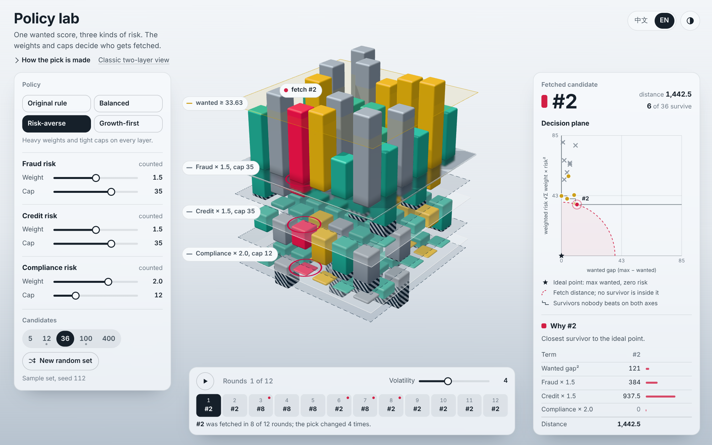

# Risk control on multiple dimensions 多維度風險控制

### [▶ 開啟策略實驗室 / Open the policy lab](https://rolanthhuang.github.io/Risk_control_on_Multi_dimension/)

<a href="https://rolanthhuang.github.io/Risk_control_on_Multi_dimension/">
  <picture>
    <source media="(prefers-color-scheme: dark)" srcset="preview-dark.png">
    
  </picture>
</a>

One wanted score, three kinds of risk. A policy is a weight and a hard cap per risk layer; the lab shows who gets fetched, why everyone else lost, and how stable the choice stays as the data drifts.

這個專案把 [Wanted / Unwanted 兩層選擇機制](https://github.com/RolanthHuang/Multi-dimensional-choices)（[線上版](https://rolanthhuang.github.io/Multi-dimensional-choices/)）推廣成多維度的風險控制：每個候選項有一個 wanted 分數和三種風險分數，選擇規則由「權重 + 硬上限」組成的策略決定。

## 選擇流程

| 階段 | 規則 | 被淘汰的候選項 |
|---|---|---|
| 1. Wanted | 保留 wanted 不低於高分群平均的候選項（與原始兩層版相同的門檻） | 未達 wanted（青綠） |
| 2. 上限 | 任何一層風險超過該層上限就擋下 | 被上限擋下（灰色） |
| 3. 距離 | 在存活者中選出與理想點距離最小的那一個 | 存活但較遠（金色） |

理想點是「wanted 等於目前最高值、每一層風險都是 0」。距離為：

```text
distance[i] = (max_wanted − wanted[i])² + Σₖ weightₖ × riskₖ[i]²
```

距離並列時，由固定 seed 的抽籤決定，結果可以重現。原始兩層版就是這個機制的特例：只有詐欺一層、權重 1、沒有上限。

## 三種風險

| 風險層 | 示範資料的特性 |
|---|---|
| 詐欺 fraud | 與原始兩層版的 unwanted 是同一組亂數，0–50 均勻分佈 |
| 信用 credit | 與詐欺風險反向、與 wanted 略為同向；詐欺低的候選項信用風險往往偏高，所以權重真的會改變選擇 |
| 合規 compliance | 大多數接近 0，少數有很高的旗標（重尾分佈），適合用硬上限處理 |

這些是合成的示範資料，用來呈現機制，不代表任何真實的風險模型。

## 預設策略

| 策略 | 權重（詐欺, 信用, 合規） | 上限（詐欺, 信用, 合規） | 想法 |
|---|---|---|---|
| 原始規則 original | 1, 0, 0 | 無, 無, 無 | 只看詐欺，等同原始兩層版 |
| 平衡 balanced | 1, 1, 0.5 | 無, 無, 30 | 每一層都計分，嚴重的合規風險直接擋下 |
| 風險趨避 averse | 1.5, 1.5, 2 | 35, 35, 12 | 每一層都重罰，上限收緊 |
| 成長優先 growth | 0.2, 0.15, 0.05 | 無, 無, 40 | 權重很輕，wanted 說了算，只擋極端的合規風險 |

上限設成 50 代表沒有上限（分數最高就是 50）。

## 頁面上能做什麼

- **3D 樓層圖**：wanted 往最上層玻璃上方長，三種風險各自一層往下掛。每一層的上限是一片虛線平面，超出上限的部分會以條紋標出。
- **策略面板**：四個預設，或用滑桿自己調整每一層的權重和上限，fetch 會立刻跟著變。fetch 換人時，會留下一條從舊 fetch 飛到新 fetch 的軌跡。
- **決策平面**：只畫通過 wanted 階段的候選項。橫軸是 wanted 差距，縱軸是加權風險 √Σ 權重 × 風險²；兩軸同比例，所以和左下角理想點的直線距離就是決策距離。
  - 虛線弧是 fetch 的距離，弧內沒有任何存活者。
  - 階梯線連起兩個軸都沒人能同時勝過的存活者，也就是 Pareto 前緣。
- **為什麼 / 為什麼不是**：游標移到任一根柱子或點上，就會說明它停在哪一關。
  - 被上限擋下的，說明超過哪個上限，以及沒有這個上限時會排第幾。
  - 存活但沒被選上的，逐項列出距離的組成，和 fetch 並排比較。
- **回合**：資料在 12 個回合中隨機漂移，波動可調整。播放後可以看到同一套策略選得穩不穩，例如「#2 在 12 回合中被選出 8 次」。
- 候選項數量可切換 5 / 12 / 36 / 100 / 400，12 和 100 就是原始兩層版的兩組資料。
- 介面支援中文 / English、淺色 / 深色。網址會記錄目前的狀態，例如 `?n=36&policy=averse&round=4`，可以直接分享。

## Python 參考實作

`risk_lab.py` 只用 Python 標準函式庫，和網頁使用同一套亂數串流（MT19937，與 `random.Random` 相同），同樣的參數會得到同樣的數字。網頁上的「用 Python 重現同一結果」會給出對應的指令。

```bash
python risk_lab.py
python risk_lab.py --num-elements 36 --seed 112 --policy averse --why 1
python risk_lab.py --weights 1,0.5,2 --caps 50,40,15 --volatility 2 --round 6
```

輸出範例：

```text
candidates: 36  seed: 112  round: 1 of 12
weights (fraud, credit, compliance): (1.5, 1.5, 2.0)  caps: (35, 35, 12)
wanted threshold: 33.63  passed: 13  blocked: 7  survivors: 6
fetch: #2  wanted 37  fraud 16  credit 25  compliance 0  distance 1442.5
fetch by round: #2 #2 #8 #8 #8 #2 #8 #2 #2 #2 #2 #2
#1 was blocked at the cap stage: compliance 32 is over the cap 12. Without the cap it would rank 7 of 7.
```

| 參數 | 預設值 | 說明 |
|---|---:|---|
| `--num-elements` | `36` | 候選項數量 |
| `--seed` | `112` | 亂數種子 |
| `--policy` | `balanced` | `original` / `balanced` / `averse` / `growth` |
| `--weights` | 無 | 自訂權重，例如 `1,1,0.5`，會覆蓋 `--policy` |
| `--caps` | 無 | 自訂上限，例如 `50,50,30`，50 代表沒有上限 |
| `--volatility` | `4` | 每回合的漂移幅度 |
| `--round` | `1` | 要報告的回合，1–12 |
| `--why` | 無 | 說明某個候選項為什麼被選或沒被選 |

也可以在程式中直接使用：

```python
from risk_lab import Policy, generate_world, build_rounds, decide, explain

world = generate_world(36, seed=112)
policy = Policy(weights=(1.0, 1.0, 0.5), caps=(50, 50, 30))
decision = decide(world.base, policy, world.tie_state)
print(decision.fetch, decision.best)
print(explain(decision, world.base, policy, candidate=1))
```

## 驗證

```bash
python -m unittest discover -s tests -v
```

- `tests/web_reference.json` 由網頁內嵌的機制程式碼產生，涵蓋 8 組候選項、4 種波動、6 種策略、每組 12 回合；Python 版必須逐回合得到相同的 fetch、門檻、存活人數、並列名單與距離。
- 「原始規則」在第 1 回合必須和原始兩層版的 `choose_candidate` 完全一致（540 組參數）。

## 檔案

| 檔案 | 內容 |
|---|---|
| `index.html` | 策略實驗室網頁（Three.js，從 jsDelivr 載入，不需建置） |
| `risk_lab.py` | Python 參考實作與命令列工具 |
| `tests/` | 與網頁、與原始兩層版的一致性測試 |
| `preview-light.png` / `preview-dark.png` | README 預覽圖 |

## 使用限制

1. 各風險層必須使用可比較的量尺；量尺差異很大時，應先正規化再設定權重。
2. 權重與上限是政策選擇，不是從資料學出來的；這個實驗室的用途是看清楚不同政策的後果。
3. 示範資料是合成的。實際的風險控制還需要資料品質、模型校準、業務規則與事後驗證。
